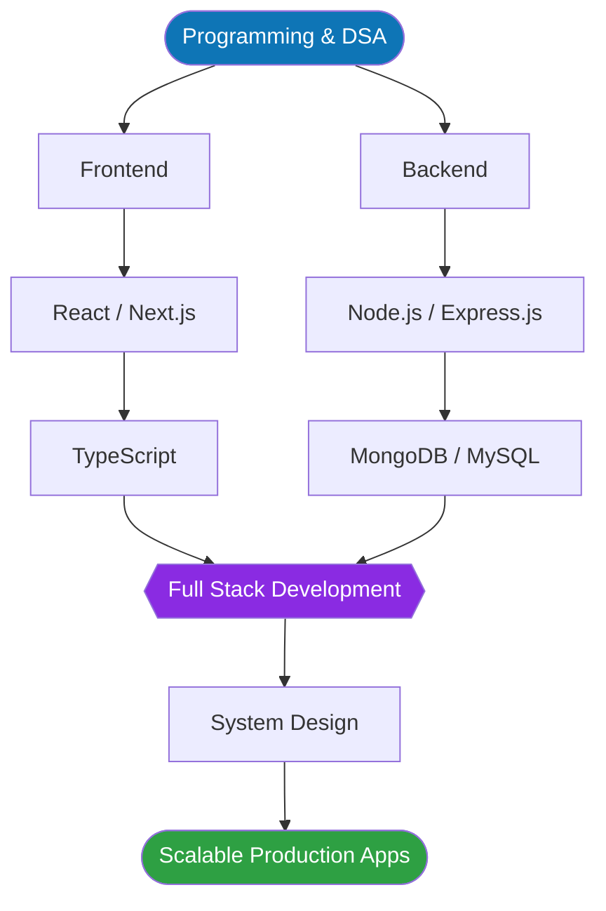

<!-- ===================== HEADER (animated wave) ===================== -->

  

<!-- ===================== TYPING ANIMATION ===================== -->

  

  
  
  

---
 
## 👨‍💻 About Me
 
- 🎓 B.Tech Computer Science student @ **IIIT Bhagalpur**
- 💻 Passionate about **Backend Engineering**, **Full Stack Development** and **Data Visualization**
- 🧠 Solved **500+ DSA problems** in **C++** across coding platforms
- 🌱 Currently exploring **System Design**, **Next.js**, **TypeScript**, **Express.js** and **MongoDB**
- ⚡ I enjoy building performant, production-ready web applications
- 🔗 Connect with me on [LinkedIn](https://www.linkedin.com/in/utsav-kumar-54b9bb322)
---
 
## 🏅 Highlights
 
- 💻 **500+ DSA problems** solved in C++
- 🥋 **Codeforces Pupil**
- 🟠 **LeetCode** — 500+ problems solved
- 🚗 Built a real-time **Uber Clone** with the MERN stack, Socket.IO and Google Maps API
---
 
## 🧠 Technical Skills
 

  

| Category | Skills |
|---|---|
| **Languages** | `C++` · `C` · `JavaScript` · `TypeScript` · `Python` · `Java` |
| **Frontend** | `Next.js` · `React` · `Tailwind CSS` · `HTML` · `CSS` |
| **Backend** | `Node.js` · `Express.js` · `Socket.IO` |
| **Databases** | `MongoDB` · `MySQL` |
| **Tools & DevOps** | `Git/GitHub` · `Docker` · `Linux` · `VS Code` · `Postman` |
 
---
 
## 🚀 Featured Projects
 
### 🚗 Uber Clone — *Real-Time Ride Booking Platform*
`MongoDB` · `Express.js` · `React` · `Node.js` · `Socket.IO` · `Google Maps API`
 
- 🔐 User & Captain authentication
- 📍 Live location tracking
- 🚕 Ride request and trip management
- ⚡ Real-time communication using Socket.IO
---
 
## 🏆 Coding & Problem Solving
 
| Platform | Achievement |
|----------|-------------|
| 🟠 **LeetCode** | **500+ problems solved** |
| 🔵 **Codeforces** | **Pupil** |
| 💻 **Primary Language** | **C++** |
 
🔗 [LeetCode](https://leetcode.com/u/utsav_20_02/) · [Codeforces](https://codeforces.com/profile/kumarutsav)
 
---
 
## 📈 GitHub Stats
 

  
  

  

  

---
 
## 🔭 Currently Working On
 
- 🏗️ **System Design** fundamentals
- ⚛️ **Next.js** and **TypeScript** for modern full stack apps
- 🛠️ **Express.js** and **MongoDB** backend development
- 📊 Data visualization
- 💻 Data Structures & Algorithms
---
 
## 💡 Learning Roadmap
 

 
---
 
## 🌐 Connect With Me
 

  
  
  
  

  

  

 
